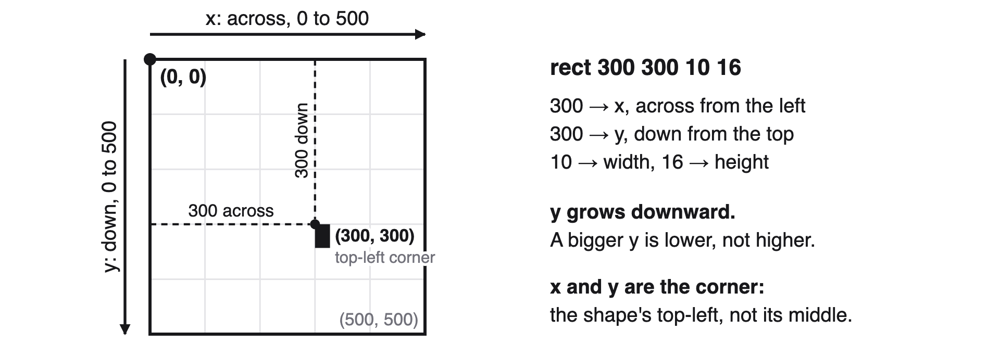

# Before We Get Started

You are going to write a program that draws confetti: sixty small rectangles in two colours, scattered at random across a blue canvas.

You will build it out of cards. Whenever your cards make a program, it runs, and the result appears on the canvas.

Work through the pages in order. Each one gives you an arrangement to build and then a list of things to change.

**How to read the table.** Lay a page on the table and its program appears as virtual cards. Put a real card on each one, left to right and top to bottom. Where a virtual card is indented, indent the real card too.

# Get a canvas

Two cards make a canvas and paint it. `[call(p5.createCanvas)]` takes two numbers: the width and the height, in pixels. `[call(p5.background)]` takes one colour card.

The `[define(setup)]` card is already on the table. Everything you build goes underneath it.

> ✴️ See the virtual cards on the table

```snap
/** @table hidden */
[import(snapscript-p5)as(p5)]

[define(setup)]
[call(p5.createCanvas)][num{500}][num{500}]
[call(p5.background)][color(mediumblue)]
```

> **You should see:** a blue square on the wall.

## Try these

The program runs again after every change. This is the loop you will be in all session: change the cards, look at what happened.

- Make the canvas a different shape. Try `[num{500}]` `[num{200}]`. Try `[num{200}]` `[num{500}]`. Which of the two numbers is the width?
- Swap the `[color(mediumblue)]` card for a different colour card. The new card lights red because it isn't the one the page shows. It still runs.
- Take the `[call(p5.background)]` row off the table entirely. Put it back.

## What just happened

A card like `[call(p5.createCanvas)]` **calls a function**: it runs a named piece of behaviour that somebody else wrote. The cards to its right are its **arguments**: the information the function needs in order to do its job.

Keep whichever canvas size and background colour you like. The rest of this textbook assumes a 500 by 500 canvas, so if you have made yours much smaller, put it back before the next page.

# Put something on it

`[call(p5.rect)]` draws a rectangle. It takes four numbers, and their order says which is which: x, y, width, height.



`x` is how far across from the left edge, and `y` is how far **down** from the top. The one that catches everybody out: **y grows downward.** And x and y are the rectangle's **top-left corner**, not its middle.

> ✴️ See the virtual cards on the table

```snap
/** @table hidden */
[import(snapscript-p5)as(p5)]

[define(setup)]
[call(p5.createCanvas)][num{500}][num{500}]
[call(p5.background)][color(mediumblue)]
[call(p5.rect)][num{300}][num{300}][num{10}][num{16}]
```

> **You should see:** a small white rectangle with a thin outline, below and to the right of the middle.

## Try these

- Change the first two numbers on the rect row to `[num{0}]` `[num{0}]`. Where does it go?
- Change them to `[num{250}]` `[num{250}]`. Is the rectangle in the middle of the canvas? If not, why not?
- Make the last two numbers much bigger.
- Build a **second** `[call(p5.rect)]` row underneath the first, with different numbers, so there are two rectangles on the canvas.

## Before you move on

Make sure everyone at the table can put a finger on the card that decides how far **down** a rectangle sits. Then turn the page.

# Colour it in

Two more cards change how shapes are drawn. `[call(p5.fill)]` takes a colour card and sets the colour that shapes are filled with. `[call(p5.noStroke)]` turns off the outline, and takes nothing at all: no numbers, no colours.

Neither of them draws anything by itself.

> ✴️ See the virtual cards on the table

```snap
/** @table hidden */
[import(snapscript-p5)as(p5)]

[define(setup)]
[call(p5.createCanvas)][num{500}][num{500}]
[call(p5.background)][color(mediumblue)]
[call(p5.noStroke)]
[call(p5.fill)][color(gold)]
[call(p5.rect)][num{300}][num{300}][num{10}][num{16}]
```

> **You should see:** the same rectangle in the same place, now gold, with no outline.

## Try these

- Move the `[call(p5.fill)]` row so that it sits **below** the `[call(p5.rect)]` row. Then put it back above.
- Swap the colour card for a different one.
- Put two `[call(p5.rect)]` rows on the table with a `[call(p5.fill)]` row in between them, each with a different colour.

## What just happened

The cards run **in order**, from the top of the strip to the bottom, once each. `[call(p5.fill)]` does not colour anything that has already been drawn: it only changes what the *next* shape will look like. That is why it has to sit above the rectangle, and why moving it below leaves the rectangle white.

## Before you move on

Make sure everyone can explain why moving the `[call(p5.fill)]` row down changed nothing about the rectangle. Then turn the page: its virtual cards show the next step.

# Give a number a name

`[set{xPos}to]` makes a **variable**: a name that holds a value. Write the name on the card yourself. `xPos` is just short for "x position", and you could call it anything.

Once a name holds a value, the `[get{xPos}]` card stands in for that value anywhere you would have put a number.

> ✴️ See the virtual cards on the table

```snap
/** @table hidden */
[import(snapscript-p5)as(p5)]

[define(setup)]
[call(p5.createCanvas)][num{500}][num{500}]
[call(p5.background)][color(mediumblue)]
[call(p5.noStroke)]
[call(p5.fill)][color(gold)]
[set{xPos}to][num{300}]
[call(p5.rect)][get{xPos}][num{300}][num{10}][num{16}]
```

> **You should see:** nothing different at all. The gold rectangle is exactly where it was.

That is the expected result. You have not broken anything.

## Try these

- Change the `[num{300}]` on the `[set{xPos}to]` row. Which rectangle moved?
- Put a second `[get{xPos}]` card in place of the `[num{300}]` on the rect row, so that x and y are both `xPos`. Then change the number on the set row.
- Add a `[set{size}to]` row and use `[get{size}]` for the width and the height of the rectangle.

## What just happened

`[set{xPos}to]` `[num{300}]` **assigns** the value 300 to the name `xPos`. After that row, `[get{xPos}]` means exactly the same thing as `[num{300}]`.

On its own this changes nothing, which is why the canvas looked the same. What it buys you is one place to change instead of several, and on the next page, one place to put something far more interesting than a plain number.

## Before you move on

Get back to one `[set{xPos}to]` `[num{300}]` row, with `[get{xPos}]` as the first number on the rect row. Then turn the page: its virtual cards show the next step.

# Make it random

Your rectangle lands in exactly the same place on every run. Change that.

> ✴️ See the virtual cards on the table

```snap
/** @table hidden */
[import(snapscript-p5)as(p5)]

[define(setup)]
[call(p5.createCanvas)][num{500}][num{500}]
[call(p5.background)][color(mediumblue)]
[call(p5.noStroke)]
[call(p5.fill)][color(gold)]
[set{xPos}to][call(random)][num{500}]
[call(p5.rect)][get{xPos}][num{300}][num{10}][num{16}]
```

To get a new random result, rewrite a number, or lift a card and lay it again. Do it a few times.

> **You should see:** the rectangle in a different place on every run. It moves left and right, but always stays at the same height.

## Try these

- Change the `[num{500}]` to `[num{50}]` and get a few new results. Then try `[num{5000}]`.
- Use random for the **width** of the rectangle instead of its position.
- Do two of these at once.

## What just happened

`[call(random)]` is the first card you have used that **returns a value**. Every other one does something and that is the end of it: `background` paints, `rect` draws. `random` draws nothing. It hands a number back, somewhere between 0 and the number you gave it, and it hands back a different one every time it is called.

`[set{xPos}to]` catches that number and gives it a name, and the rect row then uses it.

## Before you move on

Make sure everyone at the table can point at the card that decides **how far** the rectangle travels, and the card that decides **which direction** it travels in. Then turn the page: its virtual cards show the next step.

# Thirty of them

One rectangle is not confetti. You need many more, and you are not going to lay endless rows of cards.

`[repeat]` runs the rows underneath it over and over. It takes one number: how many times. The rows it repeats are the ones **indented** beneath it, and `[dedent]` marks where the repeating stops.

> ✴️ See the virtual cards on the table

```snap
/** @table hidden */
[import(snapscript-p5)as(p5)]

[define(setup)]
[call(p5.createCanvas)][num{500}][num{500}]
[call(p5.background)][color(mediumblue)]
[call(p5.noStroke)]
[call(p5.fill)][color(gold)]
[repeat][num{30}]
  [set{xPos}to][call(random)][num{500}]
  [call(p5.rect)][get{xPos}][num{300}][num{10}][num{16}]
[dedent]
```

> **You should see:** thirty gold rectangles spread out across the canvas, all in a single horizontal line, at the same height.

Work out why they are spread out sideways but not up and down, and what you would need to change to fix it. You already have everything you need.

## Try these

- Change the `[num{30}]` to `[num{5}]`. Then to `[num{300}]`.
- Make the rectangles much smaller, and make 300 of them.
- Move the `[set{xPos}to]` row so that it sits **above** the `[repeat]` row instead of inside it. Then put it back.

## What just happened

Everything indented under `[repeat]` runs once per repeat: thirty times. Because the `[set{xPos}to]` row is **inside** the repeat, `random` is called thirty separate times and hands back thirty different numbers. That is why they do not all land on top of each other.

They share a height because the second number on the rect row is still a fixed `[num{300}]`. Every rectangle gets its own x. They all get the same y.

## Before you move on

Fix the height, using the same trick you used for x. The next page's virtual cards show one way to do it.

# All over the canvas

Every rectangle now gets its own y as well as its own x.

> ✴️ See the virtual cards on the table

```snap
/** @table hidden */
[import(snapscript-p5)as(p5)]

[define(setup)]
[call(p5.createCanvas)][num{500}][num{500}]
[call(p5.background)][color(mediumblue)]
[call(p5.noStroke)]
[call(p5.fill)][color(gold)]
[repeat][num{30}]
  [set{xPos}to][call(random)][num{500}]
  [set{yPos}to][call(random)][num{500}]
  [call(p5.rect)][get{xPos}][get{yPos}][num{10}][num{16}]
[dedent]
```

> **You should see:** thirty gold rectangles scattered across the whole canvas, arranged differently on every run.

## Before you move on

Turn the page: its virtual cards show the next step.

# More colours

You have thirty pieces in one colour. Nothing new is needed for the rest.

`[call(p5.fill)]` stays in effect until another `[call(p5.fill)]` changes it. So a second copy of the whole repeat, with a different colour above it, draws thirty more pieces in that colour.

> ✴️ See the virtual cards on the table

```snap
/** @table hidden */
[import(snapscript-p5)as(p5)]

[define(setup)]
[call(p5.createCanvas)][num{500}][num{500}]
[call(p5.background)][color(mediumblue)]
[call(p5.noStroke)]
[call(p5.fill)][color(gold)]
[repeat][num{30}]
  [set{xPos}to][call(random)][num{500}]
  [set{yPos}to][call(random)][num{500}]
  [call(p5.rect)][get{xPos}][get{yPos}][num{10}][num{16}]
[dedent]
[call(p5.fill)][color(hotpink)]
[repeat][num{30}]
  [set{xPos}to][call(random)][num{500}]
  [set{yPos}to][call(random)][num{500}]
  [call(p5.rect)][get{xPos}][get{yPos}][num{10}][num{16}]
[dedent]
```

> **You should see:** sixty pieces of confetti, thirty gold and thirty pink, scattered over each other.

## Try these

This is the last page, and there is nothing left to get right. Take the sketch wherever you want it to go.

- Add a third colour. Add a fourth.
- Give each colour a different number of pieces, or a different size, so they are not all identical.
- Make one colour's pieces long and thin, and another's small and square.
- Change the background so the confetti sits on something other than blue.
- Give one colour a smaller `[num{…}]` on its `[call(random)]` cards, so those pieces gather in one corner instead of covering the canvas.
- Swap `[call(p5.rect)]` for `[call(p5.circle)]`. It takes three numbers rather than four: x, y and how wide across. Its x and y are the **middle** of the circle rather than a corner.
